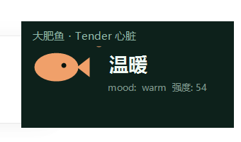

# dafeiyu-heart

> 给大肥鱼装一颗 Tender 心脏。

**最新更新 / Latest update · 2026-11-06**

新增[已知问题与坑](docs/known-issues.md)（跨学习者 403、代理路由失败、ACP 模型路由不持久、say 桥必须 UI 握手、工具随会话装配等 9 条）；新增 Tender 工具包 `tools/`：把学习状态、心智化状态卡、时间线、固定 Agent、知识库检索做成 Agent 工具（实测 Agent 已调用）；新增技术架构零基础教学 [docs/zero-basics.md](docs/zero-basics.md)：四个进程怎么分工、一条请求的十四个步骤、数据落在哪、坏了怎么降级；每轮对话结束自动打一次 Tender 心跳，把心智状态映射成大肥鱼自己的情绪并写回；
附带一个手动 bridge 和一个 Rust 记忆边车说明。本地已实测跑通。

## 这是什么

`dsh-dafeiyu-life`（大肥鱼）有自己的情绪、记忆和人格层。这个仓库不替换它，只做两件事：

1. **每轮对话 → 一次心跳**：把本轮消息截成摘要 + 哈希，交给 Tender 算心智化状态；
2. **状态 → 心情**：把状态卡映射成 `mood/intensity`，通过大肥鱼自己的 `createEmotionalState().update()`
   写回，走它的衰减与校验，不直接改 JSON。

## 结构

```
plugin/                 DSH 插件（@local/dafeiyu-heart），每轮自动打点
bridge.mjs              手动打点：node bridge.mjs --learner ... --summary ...
scripts/start-services.ps1  一键起 Tender(8080) + 记忆边车(8090)
docs/ARCHITECTURE.md    链路、数据契约、降级规则
docs/zero-basics.md     零基础教学（先读这个）
```

配套但不在本仓库：`daoql-edu-serve`（Rust 记忆边车）与 `Tender-Product`（`/heart/beat` 端点）。

## 桌宠



一个 always-on-top 的小窗，直接读鱼的心情文件，每 2 秒刷新：颜色随 mood 变，右下角显示强度。

```powershell
powershell -ExecutionPolicy Bypass -File .\scripts\desktop-pet.ps1
```

右键：打开心情文件 / 退出；按住拖动可换位置。`DAFEIYU_STATE_FILE` 可指定别的心情文件路径。
脚本必须**带 UTF-8 BOM**，否则 PowerShell 5.1 会把中文当 ANSI 读坏（仓库里已经是 BOM）。

## 装

```powershell
# 1. 起依赖服务（Tender 与记忆边车）
.\scripts\start-services.ps1

# 2. 装插件
plugin_manager install_bundle  target: <本仓库绝对路径>\plugin
```

插件配置在 `plugin/cordis.patch.yml`，四个键：`tenderUrl` / `learnerId` / `dataDir` / `emotionalStateModule`。
**注意**：宿主进程里没有 `DSH_PROFILE_DIR`、`DSH_HOME`，路径必须写绝对路径。

## 验证

跑一轮带情绪的对话，然后看两处：

```powershell
# Tender 侧：事件数、情绪标签
curl "http://127.0.0.1:8080/heart/state/dafeiyu" -H "Authorization: Bearer <token>"

# 鱼侧：心情文件
Get-Content "$env:DSH_HOME\bili-duty\life-memory\emotional-state.json"
```

插件日志：`plugin.log`（每轮一行，超过 256 KiB 自动清空）。

## 边界

- 只传**摘要（≤60 字）与哈希**，原始对话不落库；
- 情绪置信度 < 0.2 或标签为「未观测」时**不更新心情**，宁可不动也不造情绪；
- Tender 或边车不可用时只降级，不阻断对话，也不伪造状态。

License: MIT.
## Tender 工具（tools/）

装到 **acp profile**，大肥鱼的 Agent 就有了产品能力：

| 工具 | 能力 |
|---|---|
| `tender_learning_state` | 查学习状态（知识结构、元认知偏差、掌握度） |
| `tender_mentalization` | 读心智化状态卡（结论、置信度、假设、怎么帮） |
| `tender_timeline` | 看心智化时间线（认知与情绪变化、支持—反思—结果） |
| `tender_fixed_agents` | 列出固定辅助 Agent |
| `tender_agent` | 调用某个专家 Agent |
| `tender_knowledge_search` | 知识库检索 |

```powershell
dsh plugin --profile acp add <本仓库>\integrations\dafeiyu-heart\tools
```

配置在 `tools/cordis.patch.yml`：`baseUrl`（默认 8080）、`learnerId`、`actorId`。
实测：在 acp 会话里让它查状态，Agent 调用了 `tender_mentalization` 并复述了 summary、confidence 与 support_hint。
## 启用 ACP（让她用 Agent 说话 + 用 Tender 工具）

1. 在桌面右键鱼鱼 → 设置 → 「连接 Agent」 → 选 **DeepSeek Harness** → 连接
2. 同一页的「模型与权限」里，模型选 **DeepSeek Account** 组下的 `DeepSeek-V4.1-Flash`
   （不要选 `DeepSeek` 组，那条走 official 路由，本机没有 API key，会报 `no API key`）
3. 需要她在「说话」时用 Agent，把「吐字交给 Agent」打开；需要点击触发，把「点击时回应」打开

**注意**：这个模型选择**不会持久化**。清会话绑定、重启桌宠之后会退回 official，
下次连接时要重新选一遍。完整症状与排查见 [docs/known-issues.md](docs/known-issues.md) 第 1 条。

装好 `tools/` 之后，她的会话还会多出六个工具；工具随会话装配，装完要重连一次才生效。

> 本仓库是 [MK60DN/Tender](https://github.com/MK60DN/Tender) 分支 `feat/dafeiyu-heart` 里 `integrations/dafeiyu-heart` 的公开镜像。
> 以分支里的版本为准。
